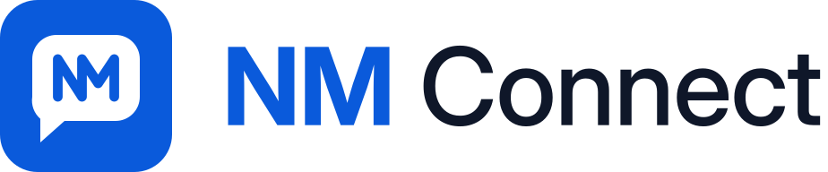

# Marca NM Connect

CRM de WhatsApp com agentes de IA, da casa NM (irmão do NM ONE). Tom: profissional,
confiável, sóbrio — atendimento jurídico e empresarial.



## O símbolo

Um balão de conversa (cantos retos arredondados, cauda à esquerda) dentro de um
ladrilho azul (`#0A5ADB`). Dentro do balão, **N e M desenhados num traço único e contínuo**:
a perna direita do N é a perna esquerda do M. Uma linha só, ligando as duas letras —
a conversa e a conexão. Não usa círculo, telefone nem verde: nada que lembre o logo do
WhatsApp ou de outra marca da Meta.

O wordmark é Inter (SIL OFL 1.1) convertida em contornos: **NM** em 700, **Connect** em
500. Os SVGs não dependem de fonte instalada.

## Arquivos

| Arquivo | Uso |
|---|---|
| `logo.svg` / `logo.png` | Logo horizontal para fundo claro (PNG com 192 px de altura, fundo transparente) |
| `logo-escuro.svg` / `logo-escuro.png` | Logo para fundo escuro ("NM" em `#5794FF`, "Connect" em `#E7F0F9`) |
| `icone.svg` / `icone-512.png` | Símbolo quadrado; legível a 16–32 px (aba, app instalado) |
| `paleta.md` | Cores, justificativa e contraste WCAG medido |
| `gerar.py` | Regera os três SVGs (precisa de `fonttools`; instruções no cabeçalho) |
| `evidencias/` | Telas da identidade ANTERIOR (vermelho + grafite, 14/10/2026), guardadas como histórico; `grafite-2B2A27-recusado-*` mostram o grafite neutro recusado pela guarda de acromaticidade |

Regras rápidas: não recolorir o símbolo fora da paleta; não esticar (o logo tem
proporção ~4,8:1 e a barra lateral o mostra com 28 px de altura); manter o ladrilho
azul com balão branco nos dois temas — é o que torna o ícone reconhecível na aba.

> **Regra de cor:** a marca e a interface usam o mesmo azul, o da paleta do produto
> (`#0A5ADB` no claro, `#5794FF` no escuro), trazida do NM ONE em 21/10/2026. Vermelho
> na tela só para erro e perigo. Cor neutra demais (ex.: `#2B2A27`) é recusada pelo sistema, que
> volta à cor padrão; ver [`paleta.md`](paleta.md).

## Como aplicar numa instalação

A marca é **configuração, não código** (ver `docs/white-label.md`): uma imagem Docker
serve qualquer marca, e o banco manda sobre o `.env`. Nada aqui edita arquivo do upstream.

### 1. Pela tela (o caminho normal)

Entre como super-admin e abra **`/admin/marca`**:

1. **Nome do sistema:** `NM Connect`
2. **Cor da marca:** `#0A5ADB`
3. **Cor da marca no tema escuro:** `#5794FF`
4. **Logo:** suba `logo.png` (sobe na hora, não depende do Salvar)
5. **Logo para o tema escuro:** suba `logo-escuro.png`
6. **Ícone do aplicativo e do navegador:** suba `icone-512.png`
7. Clique **Salvar** (grava nome e cores).

A tela só aceita **PNG ou JPG até 512 KB** — SVG é recusado pelos bytes, de propósito
(SVG pode carregar script num bucket público). Por isso os PNGs existem.

O CSS personalizado da mesma tela **não** é usado: a fonte do produto não é
configurável (`next/font` resolve no build, e o validador recusa `@font-face`/`url()`),
e a paleta não precisou de ajuste fino.

### 2. Sementes no `.env` do servidor

```bash
APP_NAME="NM Connect"
APP_ACCENT_HEX=#0A5ADB
# Opcional — o logo subido pela tela vence esta URL:
APP_LOGO_URL=https://raw.githubusercontent.com/Crud-Make/nm-connect/main/marca/nm-connect/logo.png
```

São **semente** (instalação nova já nasce com a marca) e **piso de rollback** (o
`agent.sh` reverte a imagem, nunca o banco). Os **e-mails de acesso** (confirmação e
recuperação de senha) leem o `.env`, não o banco: depois de ajustar as duas primeiras,
rode `bash hostgator-setup-kit/marca-emails.sh`.

### 3. Por organização (opcional)

Cada escritório cliente pode ter a própria marca em `/app/settings/marca` (nome, cor,
logo). O login continua com a marca da instalação — antes de entrar, o sistema não sabe
de qual organização a pessoa é.
